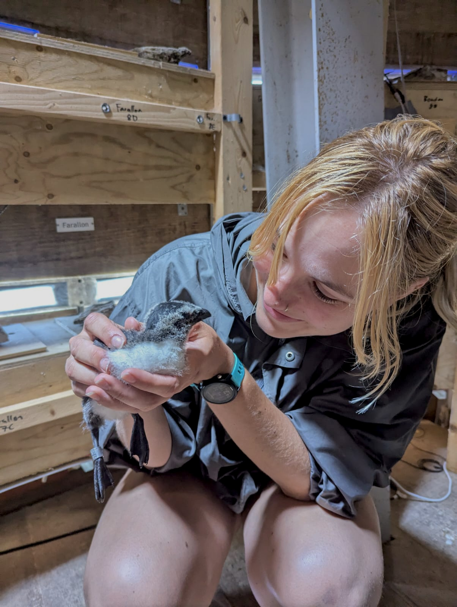
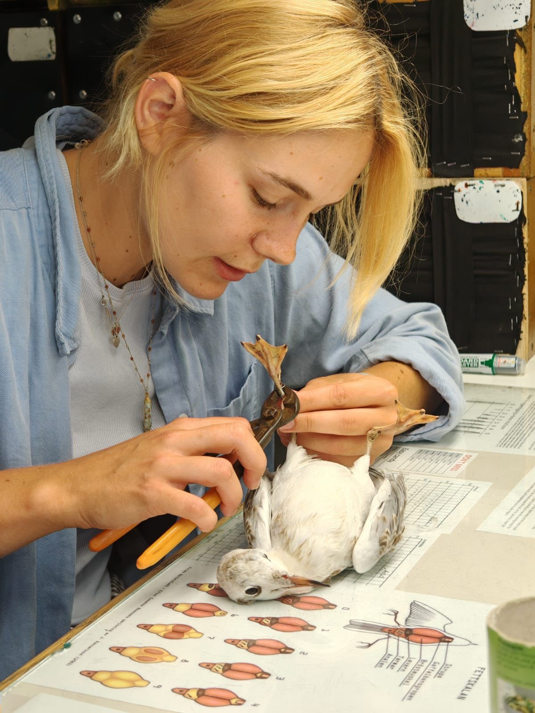

Bird ringing is a core part of my fieldwork. Over the past 2 years I have worked at ringing stations and research sites across Sweden, from seabird colonies to migration observatories.

## Stora Karlsö
{: #stora-karlso}

<figure class="align-right" style="width: 280px">
  
  <figcaption>Razorbill, Stora Karlsö.</figcaption>
</figure>

In the summer of 2025 I joined the **Baltic Seabird Project** research team on Stora Karlsö for the guillemot ringing season. My work included:

- Guillemot ringing and chick monitoring
- Data entry
- Eider and razorbill surveys
- Maintenance of the artificial cliffside (Auk Lab), including upkeep of monitoring cameras

## Ottenby Bird Observatory

<figure class="align-left" style="width: 280px">
  
  <figcaption>Ottenby Bird Observatory, Öland.</figcaption>
</figure>

During the summer and autumn of 2025, as well as autumn 2026, I worked as a **Ringing Assistant** at **Ottenby Bird Observatory (BirdLife)**, assisting with standardised ringing throughout the trapping season. My work included:

- Extracting birds from mist nets, Heligoland traps and wader cages
- Waterfowl sampling (blood, oropharyngeal and cloacal)
- Data entry
- Guided tours in English and Swedish
- Practical conservation work such as trap and vegetation maintenance

I also spent time working in the Naturum museum and the Naturbutiken gift shop.

## Landsort Bird Observatory

In autumn 2025 I also assisted with ringing at Landsort Bird Observatory.

## Upplands Ornitologiska Förening

Throughout 2025 and 2026 I have been working with **Upplands Ornitologiska Förening (BirdLife Uppland)** to set up a Constant Effort Site (CES) in Uppsala. The aim is to promote ringing and birding to the public. In this role I:

- Learn how to set up a ringing station, from practical tasks to liaising with the local community and landowners
- Assist with ringing at various sites around Uppland
